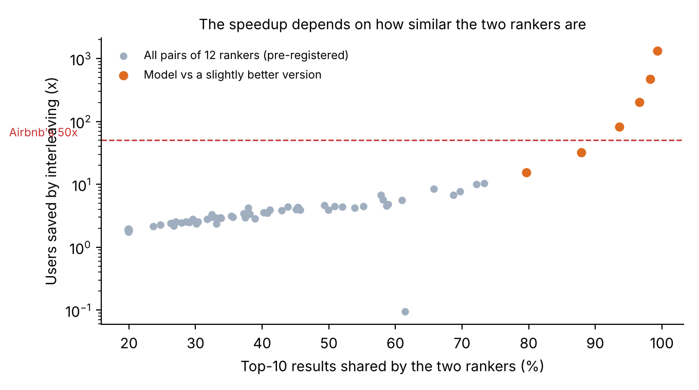
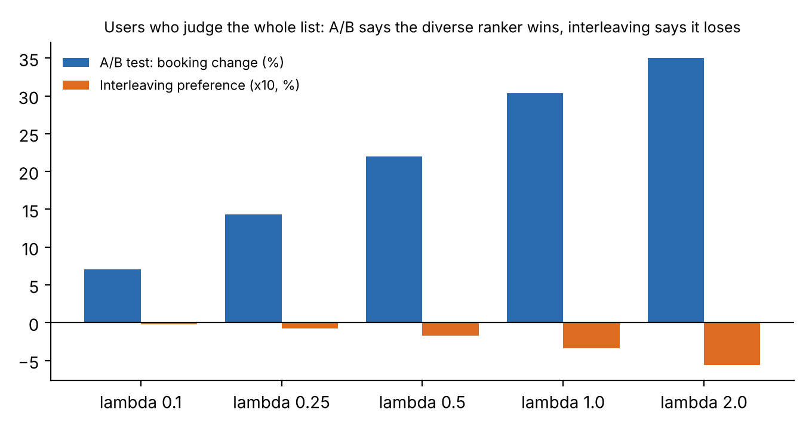

# Airbnb's interleaving for search ranking, rebuilt on MovieLens

An independent rebuild of Zhang, Deng, Du, Gao, He and Katariya, *Harnessing the Power of Interleaving and Counterfactual Evaluation for Airbnb Search Ranking* (KDD 2025, [arXiv 2508.00751](https://arxiv.org/abs/2508.00751)).

The hypotheses and pass/fail rules were committed before any simulation ran. See [PREREGISTRATION.md](PREREGISTRATION.md) and the first commit. Tests added after seeing a result are labeled exploratory in the notebook.

Tastes are real (MovieLens, 2,000 most-rated movies). Searches and bookings are simulated with a choice model, so the true A/B effect of every ranker pair is known exactly.

## Results against the pre-registration

| | Hypothesis | Result | Verdict |
|---|---|---|---|
| H1 | Position-only users: interleaving FPR within 3.5% to 6.5% | 4.3% over 2,000 tests | Pass |
| H2 | Median speedup over A/B at least 10x (paper: about 50x) | 3.0x across 66 ranker pairs | **Fail** |
| H3 | Interleaving agrees in sign with the true A/B effect in at least 80% of pairs | 100%, correlation 0.99 | Pass |
| H4 | Max / min speedup above 5 | 0.1x to 10.5x | Pass |
| H5 | A diversity ranker under hidden intent makes the methods disagree | They agreed at every strength | **Fail** |

Exploratory, added after the results above:
- Comparing a model with a slightly better version of itself, the speedup tracks how much the two top-10 lists overlap: 15x at 80% overlap, 32x at 88%, 82x at 94%, 203x at 97%.
- Under other booking models (1% or 10% booking rate, steeper attention), the median pre-registered speedup stays between 2.3x and 3.3x, and the 97%-overlap iteration between 113x and 217x.
- When users judge the whole list (a list dominated by one genre makes them leave), the A/B test says the diverse ranker raises bookings by 7% to 35%, and interleaving says it loses, at every setting.




## Files

- `airbnb_interleaving_replication.ipynb`: the full analysis, executed.
- `interleaving.py`: the same code as a script (percent format).
- `figures/results.json`: every number quoted above, including all 66 pairs.

## Run it

```
pip install numpy pandas scipy matplotlib pyarrow
jupyter nbconvert --to notebook --execute airbnb_interleaving_replication.ipynb
```

## Credit

The method belongs to the Airbnb search team and Alex Deng. This is an independent rebuild for learning. Counterfactual evaluation, the paper's second method, is not covered. Any mistakes are mine.
