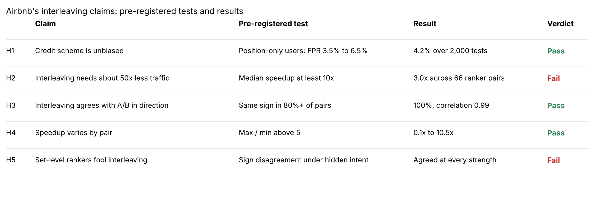
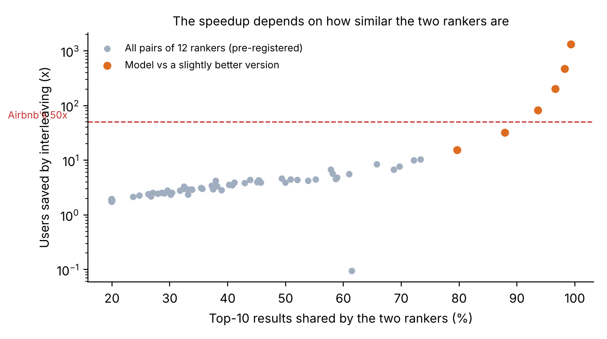
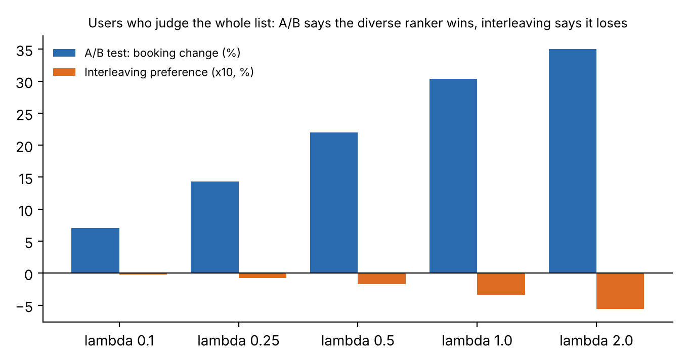

# Interleaving is 50x faster than A/B testing. Sometimes.

## I rebuilt Airbnb's ranking experiments on MovieLens. Their headline number failed my test, then explained itself.

*Part 3 of Big Tech measurement, rebuilt.*

Search teams have a traffic problem. A new ranking model might change bookings by a percent or two, and an A/B test needs weeks to see that, because most searches end without a booking whichever model is running. At Airbnb it's worse than most places, since people only travel a couple of times a year.

Interleaving is the standard way around it. Instead of splitting users into two groups, every user sees one list that mixes results from both rankers, and you watch whose results get booked. Airbnb's search team described their version in [a KDD 2025 paper](https://arxiv.org/abs/2508.00751). That "50x" is the kind of number that ends up in planning documents, so I wanted to see where it comes from.

## What Airbnb built

Their method drafts the merged list one pair at a time. At each step it takes the next unused result from each ranker. If both rankers want the same listing, it goes in once and belongs to neither. If they differ, the two listings form a "competitive pair" and both go in, with one coin flip per search deciding which ranker's listing comes first in every pair. A booking is credited to the ranker that contributed the listing, and each user counts as preferring whichever ranker won more of their bookings. The paper reports three things. Interleaving needs about 50 times less traffic than an A/B test for the same statistical power. It agreed with A/B in direction 82% of the time across 29 experiments. And it can mislead when a ranker optimizes the list as a whole, for example for diversity.

## How I tested it

Before running anything, I wrote down five hypotheses with pass or fail rules and committed them to git. The world is part real, part simulated. Tastes come from real MovieLens ratings, using the 2,000 most-rated movies and a matrix factorization of what people liked. Each search shows 10 of 50 candidate movies, attention drops further down the list, and about 3% of searches end in a "booking". Each user searches twice.

I built 12 rankers of very different quality, from one that knows the true appeal to a random one, and compared every pair. Because the booking model is known, I can compute exactly what an A/B test between any two rankers would find, and how many users each method needs for 80% power, without sampling noise in those numbers.

*Figure 1. The five pre-registered hypotheses, the rule each had to meet, and what happened.*

## The credit scheme is fair

The first check was the paper's claim that the credit scheme has no built-in bias. I simulated users who book purely by position and ignore what the movie is, then ran 2,000 interleaving tests on them. 4.3% came out significant at the 5% level, which is what a fair test should do.

## Then the headline number failed

My pre-registered rule was modest: interleaving should need at least 10 times fewer users than an A/B test for the median pair. It wasn't close. Across all 66 pairs, the median saving was 3.0 times, and the largest was 10.5 times. On one pair, two matrix factorization models of almost equal quality, interleaving needed ten times more users than A/B. Their lists were very different but neither was better, so every competitive pair was a coin toss.

Interleaving did get the direction right. It agreed with the true A/B effect in all 66 pairs, with a correlation of 0.99. The method works. The speedup just didn't look like the paper's.

## Where the 50x comes from

The pattern in the results was that the speedup grew when the two rankers were both good and similar. That made me think my pairs were the wrong test. Nobody runs an experiment between a random ranker and a near-perfect one. Real ranking work compares a model with a slightly improved version of itself.

So I added a test that wasn't in my plan, and I'm labeling it that way. I took one model and built treatments that blend in a small amount of the true appeal, so the two lists share most of their top results. When the lists shared 97% of their top 10, a change worth 1.7% more bookings, interleaving needed 203 times fewer users. At 94% overlap it was 82 times, at 88% it was 32 times, and at 80% it was 15 times.

*Figure 2. Users saved by interleaving against how many top-10 results the two rankers share. Grey: the 66 pre-registered pairs. Orange: a model against slightly better versions of itself. Log scale.*

The reason makes sense once you see it. An A/B test pays for all the noise in whether people book at all, which has nothing to do with the change. Interleaving only learns from the slots where the rankers disagree, and the closer the rankers are, the more of that noise it skips. So "50x" isn't a property of interleaving. It's a property of how small Airbnb's changes usually are. It reminds me of geo tests from my agency days: how sensitive a test is depends on the design and on what's being compared, not on the method's name.

Since the booking model is my invention, I reran this under other assumptions. With booking rates of 1% or 10% instead of 3%, the pre-registered pairs still had a median speedup of about 3x, and the 97%-overlap iteration stayed around 200x. With attention dropping much faster down the list, everything shrank, to 2.3x for the median pair and 113x for the close iteration, but the pattern held.

## Breaking it

My last pre-registered hypothesis was that I could reproduce the failure the paper warns about, where a ranker that optimizes the whole list confuses interleaving. I gave each search a hidden intent, a genre the user had in mind, and built a ranker that spreads genres across the top 10. I predicted that interleaving and A/B would disagree. They didn't. Diversity cost bookings in both, more so the harder it pushed. In hindsight, my users judged each movie on its own, so there was no list-level effect for interleaving to miss.

So I added a second test that wasn't in my plan. These users also judge the list as a whole: the more one genre dominates the top 10, the more likely they leave without booking. Now the two methods disagreed every time. In an A/B test, the diverse ranker raised bookings by 7% to 35% depending on how hard it pushed diversity. Interleaving said it lost at every setting. The merged list is already a mix of both rankers, so the benefit of diversity disappears, and what's left is a slot-by-slot comparison that the relevance ranker wins.

*Figure 3. When users judge the whole list, the A/B test (blue) and interleaving (orange, scaled by 10) point in opposite directions at every diversity strength.*

## Limits of this rebuild

The booking model is simple and invented, even if the tastes are real. Users here book at most once per search and don't come back over weeks, and there is no position bias beyond the attention curve. I didn't rebuild the paper's second method, counterfactual evaluation. And the list-level result depends on how strongly users react to a repetitive list, which I chose.

## What I take from it

I'd use interleaving the way Airbnb does, as a fast filter before an A/B test. But I wouldn't plan traffic with a speedup number from someone else's system. The saving depends on how similar the two rankers are, and you can estimate it before the test by measuring how much their lists overlap on logged searches. For any change that's about the list as a whole, like diversity, freshness or a new layout, I'd skip interleaving and go straight to an A/B test, because that's where it can confidently pick the wrong winner.

---

*Notebook and code: [github.com/ZFayFay/airbnb-interleaving-replication](https://github.com/ZFayFay/airbnb-interleaving-replication). The pre-registration is the first commit. The method belongs to Qing Zhang, Alex Deng, Michelle Du, Huiji Gao, Liwei He and Sanjeev Katariya. This is an independent rebuild of their [KDD 2025 paper](https://arxiv.org/abs/2508.00751). Any mistakes are mine.*
